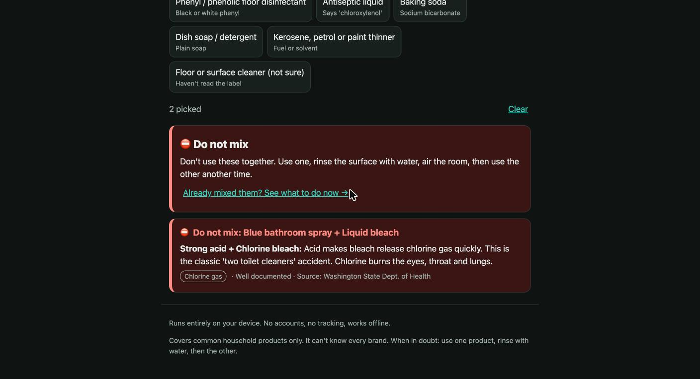
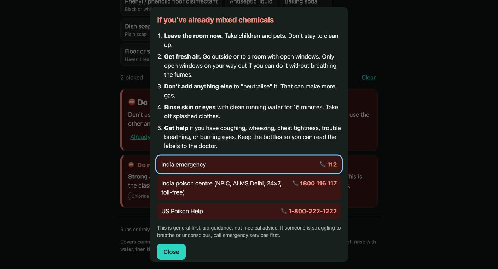
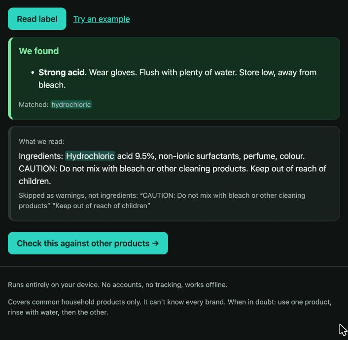

# Don't Mix 🧪

**Check your cleaning products before you mix them or store them together.**
English and हिन्दी. Works offline. Nothing leaves your phone.

**Live demo:** https://shineyrbl-byte.github.io/dont-mix/

Built for **SafeSpace Hacks 2026**.



---

## The problem

Someone is cleaning a bathroom. The toilet cleaner isn't strong enough, so they add bleach. Many toilet cleaners are acid-based (hydrochloric acid), and acid + bleach releases **chlorine gas** in a small, closed room.

This is one of the most common accidental poisonings at home. It happens because:

- Bottles look similar, and brands don't say "acid" or "bleach" on the front.
- "Stronger together" feels like common sense.
- The warning, if there is one, is in tiny print on the back, often only in English.

**Who it helps:** anyone who cleans a home, hostel, PG or small shop, especially people who are new to it (students living alone, new domestic workers, people helping elderly relatives) and people who don't read English labels.

## What it does

| Feature | What the person can do more safely |
|---|---|
| **Check a mix** | Pick two or more of 28 product types and get a clear verdict (⛔ Do not mix / ⚠️ Avoid / ❔ Not sure / ✅ No known reaction), the gas it makes, why, a **safer way to do the job**, the simplified reaction, how well documented it is, and the source. |
| **Read a label** | Paste the text from the back of a bottle. It finds hazardous ingredients (English and Hindi names) and highlights the words it matched. It **skips warning text** like "Do not mix with bleach" so it isn't mistaken for an ingredient. |
| **📷 Scan a label photo** | Take a photo of the bottle. Text recognition runs **in the browser**, so the photo is never uploaded. You can check and fix the text before it's read. |
| **My cupboard** | List what's under the sink, including products saved from a label. It tells you which bottles shouldn't share a shelf (leaks can react), which pairs must never be used back to back, and gives storage basics. Saved only on this device. **Share the list** with family or flatmates; opening a shared list always asks before changing yours. |
| **🖨️ "Never mix" sticker** | Print a sticker for the inside of the cupboard door: the five always-dangerous pairs, the risky pairs in *your* cupboard, emergency numbers, and a QR code that opens the app. |
| **Learn** | An 8-question quiz built from the same rules as the checker, so it can never disagree with the app. Every answer explains why. |
| **🔗 Share / 🔊 Read aloud** | Send a check to family as a link (only product types are in the link, never label text). Hear the verdict read out in English or Hindi when your hands are busy. |
| **Already mixed something?** | One tap opens a ready-made line to read to the poison centre (what was mixed and what it may give off), first-aid steps for fumes, swallowing and eye splashes (including "call for a child even if they seem fine"), and tap-to-call numbers: 112, the **AIIMS National Poisons Information Centre (1800 116 117)** and US Poison Help. |
| **How it decides** | An in-app page with the full rule table (result, confidence, source for every reaction), privacy, limitations, and a link to report mistakes. |
| **English / हिन्दी** | Every screen, product, warning and safer-way tip is in both languages. |
| **Settings** | Text size (A / A+ / A++), Auto / Light / Dark theme, install as an app, "ready to use offline" indicator, higher contrast when the system asks for it, and **Delete my data** (two taps) to clear everything the app stored on the device. |

### Example of the safer outcome

> Product A label: *"Hydrochloric acid 9.5%… Do not mix with bleach."*
> Product B: liquid bleach.
>
> **Before:** the person pours both into the toilet bowl.
> **With Don't Mix:** ⛔ *Do not mix: acid makes bleach release chlorine gas quickly.*
> **Safer way:** *pick one toilet cleaner. If it isn't enough, flush several times, open the window, and use the other one another day.*





## Trust and responsible design

- **No AI guessing.** Every verdict comes from a fixed, readable rule table ([`js/data.js`](js/data.js)), so the same input always gives the same answer. The quiz is generated from the same table.
- **Fully inspectable.** The "How it decides" page lists every rule with its source.
- **Shows its confidence.** Each reaction is marked *well documented* or *expected from the chemistry, less household data*, with a source.
- **Never says "safe" when it doesn't know.** Unrecognised labels and "not sure" products return ❔ *Not sure*, never ✅. Even ✅ says to use one product at a time.
- **Errs on the side of warning.** If a label says "Contains bleach, do not mix with acids", only the warning part is skipped, so the bleach is still found.
- **Private by default.** No server, no accounts, no analytics. Nothing is stored until you use a feature, and "Delete my data" clears it all. Photos are read on the device. The cupboard list stays in your browser. Share links contain only product types.
- **Works offline.** A service worker caches the whole app. Photo scanning needs internet once to download the text reader, and is cached after that.
- **Accessible.** Keyboard and screen-reader friendly tabs, results announced as they change, colour + icon + words for every level, text size control, light/dark and high-contrast support, read aloud.

## Limitations (what it can't do yet)

- **It only knows common product types and ingredient names.** It can't recognise every brand, and a label with no chemical names returns *Not sure*.
- **Photo scanning can misread** small, curved or blurry text, and is slower on old phones (around 15–20 seconds). People are asked to check the text.
- **It covers mixing and storage**, not every hazard of each product on its own (beyond a short tip).
- **Some reactions have less household-scale data** (for example bleach + phenolic disinfectants). These are marked as such and treated as unsafe.
- **The Hindi text** was written with AI help and should be reviewed by a native speaker with a safety background.
- **It is not medical advice.** In an emergency, call for help first.

## How it works

```
index.html             page, tabs, emergency dialog
js/data.js             hazard groups, reaction rules (+ equations, safer way, sources), products, label keywords
js/data.hi.js          Hindi for all of the above
js/i18n.js             UI strings in English and Hindi, language switch
js/engine.js           pure logic: checkPair, checkAll, checkStorage, parseLabel, share links, quiz builder
js/mix.js              "Check a mix" tab
js/label.js            "Read a label" tab
js/ocr.js              photo scan (Tesseract.js, loaded only when used)
js/cupboard.js         "My cupboard" tab (localStorage)
js/print.js            printable sticker
js/quiz.js             "Learn" tab
js/actions.js          share link and read aloud
js/settings.js         text size, install, offline status, update notice
js/about.js            "How it decides" page
sw.js                  offline cache
tests/                 35 tests: rules, label parser, translations, share links, offline cache list
```

Each product belongs to one or more **hazard groups** (chlorine bleach, ammonia, strong acid, mild acid, caustic, peroxide, alcohol, phenolic, flammable…). Rules describe what happens when two groups meet. For products in several groups, the worst pairing wins.

The label parser:
1. Rejoins lines that were wrapped mid-sentence (common in photo scans).
2. Skips warning text from "do not mix…", "keep away from…" (or the whole clause in Hindi, where the verb comes last).
3. Removes negations ("bleach-free", "no ammonia").
4. Matches whole words only, longest phrase first, in any script ("oxygen bleach" is peroxide, not chlorine; "polyethylene" doesn't match "lye").

## Run it

No build step. Nothing to install for the app itself.

```bash
git clone https://github.com/shineyrbl-byte/dont-mix.git
cd dont-mix
python3 -m http.server 5173     # then open http://localhost:5173
npm test                        # 35 tests (Node 18+)
```

To try photo scanning, use `tests/fixtures/sample-label.png`.

## Built during the hackathon

Everything in this repo was written during SafeSpace Hacks (Oct 17 – Nov 22, 2026). The commit history shows the step-by-step build. The only third-party code is Tesseract.js (loaded when someone scans a photo) and qrcode-generator (loaded when printing the sticker), both from a CDN and pinned to exact versions.

## Sources and credits

- [Washington State Dept. of Health: Dangers of mixing bleach with cleaners](https://doh.wa.gov/community-and-environment/contaminants/bleach-mixing-dangers) (bleach + ammonia / acids)
- [AIIMS New Delhi: National Poisons Information Centre](https://aiims.edu/index.php/en/npic_intro) (toll-free 1800 116 117, 24×7)
- US Poison Help line: 1-800-222-1222
- Other reactions (bleach + alcohol, peroxide + vinegar, acid + caustic) are standard chemistry and are labelled in the app with their confidence level.
- [Tesseract.js](https://github.com/naptha/tesseract.js) 5.1.1 (Apache-2.0) for on-device text recognition.
- [qrcode-generator](https://github.com/kazuhikoarase/qrcode-generator) 1.4.4 (MIT) for the sticker's QR code.
- First-aid wording for swallowing and eye splashes follows standard poison-centre advice (don't induce vomiting; rinse eyes for 15 minutes).
- **AI assistance:** built with help from Claude Code (Anthropic) for code, wording and Hindi translation. The safety rules were checked against the sources above.

## What I learned

- The hardest part of a safety tool is saying "I don't know" clearly. An app that says "safe" when it isn't sure is worse than no app.
- Label text is full of the chemical names a product *doesn't* contain ("do not mix with bleach"). Naive keyword matching gets this exactly backwards, and an over-eager fix can hide real ingredients.
- Word order matters: Hindi puts the verb last, so the same warning rule needed different handling.

## License

MIT
